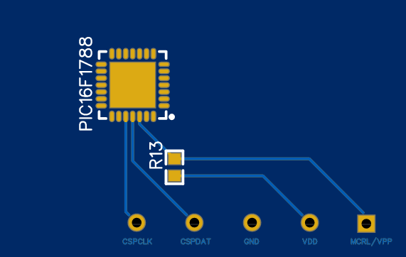
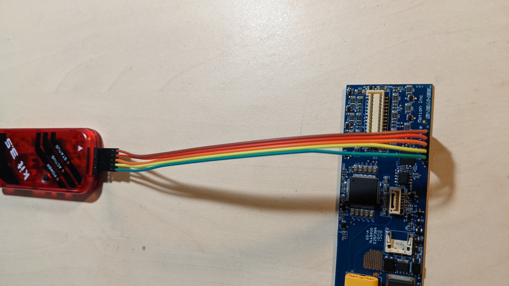

**Contents:** [Tools](#tools) · [Wiring](#wiring) · [Downloading the firmware](#downloading-the-firmware) ·
[Now what?](#i-have-the-hex-file-now-what) · [Expectations / Limitations](#expectations--limitations) ·
[What the firmware does](#what-the-firmware-does): [the backups](#the-backups-behind-this),
[the chip](#the-chip-and-its-configuration), [pins and front end](#what-the-firmware-sees-on-the-board),
[power-up](#power-up-sequence), [main loop](#the-main-loop), [serial protocol](#serial-protocol-bms-to-controller),
[EEPROM layout](#eeprom-layout), [behaviour](#how-the-firmware-behaves), [variants](#firmware-variants),
[pairing](#pairing-what-the-bms-actually-does), [practical consequences](#practical-consequences),
[what is not in the firmware](#what-is-not-in-the-firmware), [what I do not know](#what-i-do-not-know).

# Tools

You will need additional hardware to manipulate the firmware in the BMS:
* PICkit3 programmer (original) [https://www.microchip.com/Developmenttools/ProductDetails/PG164130](https://www.microchip.com/Developmenttools/ProductDetails/PG164130)
* PICkit3.5 (clone, I tested with this one) [https://www.hadex.cz/p/m545a-programator-pickit3-5](https://www.hadex.cz/p/m545a-programator-pickit3-5)
* Other versions will be probably fine too. You will just have to research bit more.

As for software, you will need **MPLAB IPE**
* **Dowload:** It's included in a package together with MPLAB X IDE: [https://www.microchip.com/en-us/development-tools-tools-and-software/mplab-x-ide](https://www.microchip.com/en-us/development-tools-tools-and-software/mplab-x-ide)
* Read more about `MPLAB IPE`: [https://www.microchip.com/en-us/development-tools-tools-and-software/embedded-software-center/mplab-integrated-programming-environment](https://www.microchip.com/en-us/development-tools-tools-and-software/embedded-software-center/mplab-integrated-programming-environment)

# Wiring

* PICkit3 basic pinout: [pickit3_50002010B.pdf](assets/pickit3_50002010B.pdf)
* BMS `PROG1` pinout:
  * 
* Just connect pins with the same name together.
  * 
* Connect PICkit to PC.

# Downloading the firmware

[](https://www.youtube.com/watch?v=gtJDZtsUXzQ)

# I have the `*.hex` file. Now what?

* [Consider supporting me.](https://github.com/sponsors/radimklaska) :)
* Check the BMS PCB revision (something like `2.0.5` in the corner of the PCB), board hardware version (`4209`, in your app, under `dignostics`) and send info about your versions and `.hex` file to [radim@klaska.net](mailto:radim@klaska.net). Thanks! :)
* Have a look at [https://ghidra-sre.org/](https://ghidra-sre.org/)
  * This will decompile the `*.hex` and show actual code. (Keep in mind that decompiled code is ugly and not very intuitive.)
* If your board is `4210` or newer, keep the backup in case you need to replace your BMS (Not confirmed to work.)
* I have reverse-engineered the backups sent so far. What the firmware does - the serial
  protocol, the EEPROM map, state-of-charge counting, protections, the 4210 / Pint
  differences and what "pairing" really is on the BMS side - is described in
  [What the firmware does](#what-the-firmware-does) below.

# Expectations / Limitations

**What matters is the combination of hardware revision _and_ firmware version.** The
hardware revision alone does not decide whether a battery upgrade will work — a `4210`
board behaves very differently on `Gemini - 4144` than on `Gemini - 4165`.

Find both in the official app under `Diagnostics`. Hardware revisions are `42xx`;
XR firmware is styled `Gemini - 41xx`. They are easy to mix up.

## By hardware revision

|Relevant revisions|Expectation/Limitation|Note|
|---|---|---|
|4206 - 4209|No controller <-> BMS pairing. Battery upgrades work without a chip.||
|4210|**Controller <-> BMS pairing starts here.** Battery upgrades still possible on `Gemini - 4144` and older; a JWFFM or Owie chip is needed otherwise.|From `4210` the update process also pulls a **bootloader**, not just the firmware file. On the BMS side the pairing is only a serial-number broadcast; the controller does the checking - see [Pairing](#pairing-what-the-bms-actually-does) below.|
|4211|Paired. Battery upgrades need a chip.||
|4212|Paired. `Code Protection` enabled on the PIC on the BMS = no firmware downloads.|If the PCB is still the same, it should be possible to replace the chip and program it with older fw. It may not be paired any more, but it should work with older boards at least. Downgrading firmware on `4212` has been reported to leave boards unbootable.|
|4213|Paired. Same expectations as `4212`.|Not confirmed whether the `4212` downgrade limitation applies here.|

## By firmware version

|Firmware|Expectation/Limitation|Note|
|---|---|---|
|`Gemini - 4144` and older|Battery upgrades work. On `4210` hardware no chip is needed.|`4134` is the common shipping firmware for `4206` - `4209`.|
|`Gemini - 4150` - `4162`|Battery upgrades need a JWFFM or Owie chip.||
|`Gemini - 4165`|**Battery upgrades are not possible - a chip does not help.**|This is the haptic buzz firmware from the CPSC recall. The same file is used for every board; `4210` and newer also pull a new bootloader.|

There is also an authentication change at **`Gemini - 4141`**: older firmware uses a
challenge/response handshake, newer firmware uses serial-based authentication. Some
community tools support only one or the other.

General limitations of working with BMS firmware:
* Most likely no bigger battery "unlocks" for `4210` or newer with BMS alterations.
* A used board that a previous owner updated to `Gemini - 4165` has lost the ability to
  take a bigger battery.

Note: much of the above is aggregated from repair shops and the community rather than
from Future Motion, and some of it is still theory for me. Corrections welcome - see
[Credits]({{ site.baseurl }}/credits/).

# What the firmware does

The rest of this page describes what the BMS firmware does: the serial protocol between the BMS and
the controller, the EEPROM layout, how the state of charge is counted, what the
protections and shutdown reasons are, how the 4210 and Pint images differ from the older
XR ones, and what the BMS really does about "pairing". It is the result of reverse
engineering the firmware backups people sent me after following the steps above.
Thank you all.

**What this part is not.** It contains no firmware code, no disassembly and no backups,
and I do not publish or hand out those. Everything below is behaviour described in words
and numbers - the kind of information you need to repair a board, replace one, or talk to
it over the serial link.

**Confidence.** Unless marked otherwise, a statement is *observed*: read directly from
the code (registers, timing constants, thresholds, message layouts, EEPROM map). Items
marked *inferred* are my interpretation (the physical meaning of a pin, what the
controller does with a message, and every figure in amperes or ampere-hours, which rests
on one external measurement). The open questions are listed at the end.

# The backups behind this

22 backups, which boil down to **6 distinct firmware images**. Backups with the same
image are byte-for-byte the same program; they differ only in EEPROM contents and in
the user-ID words of the chip. A seventh image, Pint firmware 3008, is known only from
serial captures published by the Owie project - see
[Pint firmware 3008](#pint-firmware-3008-no-backup) below.

| image | boards it came from | BMS PCB | backups | boot version (message `0x0B`) | version byte (message `0x08`) |
|---|---|---|---|---|---|
| XR 4206 | 4206 | 2.0.3 | 2 | 2006 | `04` |
| XR 4208/4209 | 4208, 4209 | 2.0.3 - 2.0.5 | 9 | 2006 | `02` |
| XR 4210 | 4210 | 2.0.5 | 1 | 2007 | `02` |
| Pint 5300 | 5300 | 2.0.5 | 4 | 3004 | `06` |
| Pint 5314 | 5314 | 2.0.5 | 1 | 3005 | `06` |
| code-protected | XR 4210, 4211, 4212, Pint, Pint X | 2.0.7 - 2.0.8 | 5 | - | - |

* The XR 4206 and 4208/4209 images differ in **one byte**: the version byte sent in
  message `0x08`. Nothing else.
* The XR 4210 image is the 4208/4209 code plus a serial-number message and a battery
  ageing model (capacity, cycle counter, state of health).
* The Pint images are the 4210 generation plus a separate charge-enable output and a
  charge-current limit. The 5300 and 5314 images differ in two details only.
* The code-protected boards (PCB 2.0.7 and 2.0.8) read back as zeros. Only their
  configuration words and user ID are real; one 2.0.8 board also exposes its EEPROM
  (data protection was left off), and that EEPROM has the 4210 layout.

So in practice there are four generations of behaviour: XR up to 4209, XR 4210,
Pint 5300 and Pint 5314. Everything that is not listed as a difference below is the same
in all five readable images.

# The chip and its configuration

The BMS runs on the `PIC16F1788` identified on the [BMS Info]({{ site.baseurl }}/bms/)
page: 16K words of program flash, 2 KB RAM, 256 bytes of data EEPROM, running at 32 MHz
from the internal oscillator with the PLL.

| setting | value | why it matters |
|---|---|---|
| oscillator | internal, 32 MHz | no crystal to fail |
| watchdog | always on, about 4 s, cleared once per main loop | a stalled firmware resets within seconds |
| MCLR | pin used as an input | the chip is reset only by power or the watchdog |
| code / data protection | **off** on every readable image | that is why these boards can be backed up at all |
| programming | high-voltage programming only | matches the PICkit [wiring](#wiring) above |

The code-protected 2.0.7 / 2.0.8 boards were built with the same options apart from
protection; two of the three 2.0.7 boards (and the one of unknown PCB revision) also
leave the watchdog under software control, and the 2.0.8 one leaves the data EEPROM
readable.

**Program structure.** One main loop and one interrupt handler. No RTOS, no bootloader,
and no command that writes program memory - in these five images the only way to change
the BMS firmware is the programming header. A 1 ms timer tick drives the timing: the
current is sampled on every tick, the measurements and most messages run once per second
(see [The main loop](#the-main-loop)). The UART interrupt collects frames from the
controller.

# What the firmware sees on the board

The pin usage, so you can relate the firmware to the PCB. The physical role of each pin
is *inferred* from how the firmware uses it unless it is obvious from the hardware.

| pin | direction | what the firmware does with it | role |
|---|---|---|---|
| RA0 | analog | sampled every 1 ms, zero expected at mid-scale (2048 counts) | **pack current sensor**, bidirectional |
| RA1 | out | high at boot, driven low as the very last step of a shutdown | **power latch / self-hold** - low powers the BMS off |
| RA2 | analog | thermistor, 10 kΩ pull-up | pack thermistor T3 |
| RA3 | reference | external 4.5 V ADC reference | cell mV = counts × 4500 / 4095 |
| RA4 | out | low = off; pulsed during pre-charge; XR images also switch it off to stop charging | **main output (discharge) FET enable** |
| RA5 | analog | read after every front-end mux command | the MAX14921 analog output (cell voltages, 3 thermistors) |
| RA6 | out | high at boot and before every cell scan | front-end enable (never cleared) |
| RA7 | out | pulsed low for 100 ms, twice, at boot | front-end reset / wake |
| RB0 | out | high while the UART transmits, low 200 µs after the last byte | driver enable of the RS-485 transceiver |
| RB1 | in | sampled every 1 ms, low time counted; shutdown waits for it to go high | **power button**, active low |
| RB2 | analog | thermistor with a different curve, clamped at 175 °C | board / FET temperature T4 |
| RB3 | analog | 5-sample average every 100 ms; about 1.98 V or more = "charger present" | **charger voltage sense** |
| RB4 | out, **Pint images only** | high while a charger is detected, low to suspend charging, low at shutdown; unused on XR | charge-enable (charge FET or relay) |
| RB5 | in | polled on every pass of the fast loop; high on two samples 2 ms apart = fault `QC` | hardware fault input (over-current comparator or latch) |
| RC0 | out | high at boot, low at shutdown | power enable for a peripheral (reference or sensor supply) |
| RC1 | out | SPI chip select, 3 bytes per transaction | MAX14921 chip select |
| RC3, RC4, RC5 | SPI | SPI master, 8 MHz, mode 0; the data coming back is never read | MAX14921 bus |
| RC6, RC7 | UART | 115200 8N1 | **controller link** |

The ADC is 12-bit. Comparators, DACs, op-amps and the PWM peripheral are not used.

## The cell-monitoring front end

The firmware only ever **writes** 24 bits over SPI and then reads one analog pin. That
24-bit word matches the control word of the `MAX14921` on the
[BMS Info]({{ site.baseurl }}/bms/) page bit for bit (Table 1 in its
[datasheet]({{ site.baseurl }}/assets/MAX14920-MAX14921.pdf)): 16 cell-balancing bits
followed by the enable-cell-select, four cell-select, sample/hold, diagnostic and
low-power bits.

* The first 16 bits are the **balancing mask**: one bit per cell, cell 1 shifted out
  first. Only 15 of the 16 are ever used.
* The last byte selects what appears on the analog output: a cell (one of 15), one of the
  three thermistor inputs, or nothing.
* Every command is sent **twice**. A cell scan starts with a sample command, waits 20 ms,
  switches to hold, then reads the 15 cells one by one: about 3 µs settling, five ADC
  conversions averaged, scaled to millivolts. The thermistor channels are read once after
  two dummy conversions.
* The diagnostic features of the chip are not used; the firmware never looks at what the
  chip sends back.

## Temperatures

Five NTC channels, each a 10 kΩ thermistor with a 10 kΩ pull-up to 5 V, converted with
the Steinhart-Hart equation:

| channel | where it is read | curve | clamp |
|---|---|---|---|
| T0, T1, T2 | through the MAX14921 thermistor inputs | 10 kΩ at 25 °C, β ≈ 3400 K | 105 °C |
| T3 | RA2 directly | same curve | 105 °C |
| T4 | RB2 directly | 10 kΩ at 25 °C, β ≈ 3950 K | 175 °C |

Results are bytes in °C: 0 means "0 °C or colder", 255 means "above the clamp". The pack
minimum / maximum used for protection and status only cover **T0 to T3** - the four pack
thermistors listed on the [BMS Info]({{ site.baseurl }}/bms/) page. T4 is reported but
never trips anything, which is why I take it for a board or FET temperature (*inferred*).

## Current

* 12-bit ADC through the 4.5 V reference. The sensor zero is measured at boot: 64 samples
  1 ms apart, averaged, accepted only within 2048 ± 15 counts. Up to 10 attempts, then
  fault `CS`.
* The reported current is the mean of the last 16 samples (one per millisecond, so a
  16 ms window), in **raw ADC counts** relative to that zero. Positive is discharge,
  charging is negative.
* **The firmware never converts counts to amperes.** The controller receives raw counts,
  so the A-per-count scale cannot be read out of the BMS code. The
  [Owie](https://github.com/lolwheel/Owie) project measured about **55 mA per count** on
  a Pint. That fits the board: it means a gain of 20 on the 1.00 mΩ shunt
  (4.5 V / 4095 / 0.020 V/A = 54.9 mA per count), and it turns the state-of-charge full
  scales below into 5.9 Ah (XR) and 2.6 Ah (Pint) for packs rated 6.0 Ah and 2.7 Ah. It
  is a measurement, not something in the code, so every ampere figure on this page is
  *inferred* from it.

# Power-up sequence

1. Peripherals set up, RAM initialised, output FET off, power latch (RA1) taken high.
2. Front-end reset pulse, twice.
3. Timers, ADC and interrupts enabled. The EEPROM configuration block is loaded and its
   checksum verified; on a mismatch the defaults are written back (including a state of
   charge of about 30 %).
4. 50 ms pause, then the **current-sensor zero calibration** described above.
5. **Pre-charge** of the output for 600 ms: the output FET is switched on and pulsed off
   for 300 µs whenever the current rises 68 counts or more above zero. If the current is
   still that high at the end of the 600 ms → fault `PR` and power-off.
6. Boot message `0x0B` (the version number), then the main loop.

Keep the output unloaded for the first second after power-up when testing on the bench;
otherwise the board shuts down with `CS` or `PR` before it ever talks to you.

# The main loop

The loop has two tiers. The **fast loop** runs on every pass, about once per millisecond:

1. Clear the watchdog.
2. Handle a received frame, if any.
3. Check the hardware fault input (RB5).
4. On every 1 ms tick: sample the current, update the 16-sample average, run the
   over-current check, update the state-of-charge counter.
5. Every 100 ms: send `05` (current), `00` (status flags) and `01` (shutdown countdown)
   when one is running; check the charger edge and the power button.

Once per second the loop also runs the **measurement block**, in this order:

1. Subtract the self-discharge allowance from the state-of-charge counter.
2. Send messages `05` (current), `08` (version byte), `07` (thresholds), `03` (SOC %).
3. Read the five thermistors.
4. Scan the 15 cells and re-send the balancing mask to the front end.
5. Send messages `02` (cells), `0C` (balancing mask), `04` (temperatures), `09` (last
   fault).
6. Charge-complete check, over-voltage, under-voltage, critical under-voltage and
   over-temperature checks.
7. Choose the cells to balance.
8. Idle timer (zero-current shutdown).

The measurement block takes tens of milliseconds - the 20 ms front-end sampling delay,
75 ADC conversions for the cells, floating-point maths for the thermistors and 99 bytes
of serial output; captures show message `02` leaving about 42 ms after the second
starts. While it runs, the 1 ms current sampling is suspended and the missed ticks are
not caught up afterwards. Everything below that is counted "per second" - the shutdown
countdowns, the idle timer - lives in this block, so those counts are real seconds. The
same structure is in all five readable images.

# Serial protocol (BMS to controller)

| item | value |
|---|---|
| link | UART, **115200 baud, 8N1**, through the RS-485 transceiver; RB0 is the driver enable |
| header | every frame starts with `FF 55 AA` |
| byte order | all multi-byte numbers are **big-endian** |
| checksum | 16-bit sum of every byte of the frame before the checksum, header included |
| timeout | a gap of more than 65 ms between bytes resets the receiver |
| TX buffer | 128 bytes; the oldest byte is dropped on overflow |

## Frames from the BMS

```
FF 55 AA  <type>  <payload ...>  <ck_hi> <ck_lo>
```

There is no length byte - the receiver has to know the payload size per message type.
Example, state of charge 50 %: `FF 55 AA 03 32 02 33`.

## Frames to the BMS

```
FF 55 AA  <len>  <payload ...>  <ck_hi> <ck_lo>
```

`len` counts the payload plus the two checksum bytes (payload length + 2) and must be
20 or less. Example, "set the over-voltage threshold to 4300 mV":
`FF 55 AA 05 00 10 CC 02 DF`. A frame with a wrong checksum is dropped by the XR images
and **echoed back** (from the length byte on, without header) by the Pint images.

## Messages sent by the BMS

"Every second" means the measurement block of the main loop; the 100 ms messages come
from the fast loop and are independent of it.

| type | payload | when | meaning |
|---|---|---|---|
| `00` | 1 byte | every 100 ms | status flags, see below |
| `01` | `seconds`, `reason` | every 100 ms while a shutdown countdown is below 29 | `seconds` = smallest remaining countdown; `reason` bits: 1 over-voltage, 2 under-voltage, 4 over-temperature, 8 idle timer |
| `02` | 16 × uint16 | every second | cell voltages in **mV**, cell 1 to 15, then a 16th word that is **not a cell**: the milliseconds elapsed since the start of the current second (about 42 ms in captures). Payload 32 bytes, frame 38 bytes |
| `03` | 1 byte | every second | state of charge in **%** |
| `04` | 5 × uint8 | every second | temperatures T0 to T4 in **°C** |
| `05` | int16 | every second and every 100 ms | pack current in raw ADC counts, positive = discharge |
| `06` | 4 bytes | **4210 and Pint images only**: every second (4210, Pint 5314) or once after boot (Pint 5300) | serial number, see "Pairing" |
| `07` | `ov_hi ov_lo full_hi full_lo uv_hi uv_lo ot` | every second | the four thresholds: over-voltage mV, charge-complete mV, under-voltage mV, over-temperature °C |
| `08` | 1 byte | every second | version byte: `04` (4206), `02` (4208 / 4209 / 4210), `06` (Pint) |
| `09` | 1 byte | every second | the last shutdown reason, read from EEPROM at boot (table below) |
| `0B` | uint16 | once at boot | firmware version: 2006 (XR 4206 - 4209), 2007 (XR 4210), 3004 (Pint 5300), 3005 (Pint 5314), 3008 (newer Pint, captures only) |
| `0C` | uint16 | every second | the balancing mask currently applied |
| `0D` | `cycles_hi cycles_lo soh` | every second, **4210 and Pint only** | cycle counter and state of health in % |
| `0E` | 1 byte | **Pint only**, reply to a command | `01` after a successful unlock, `B6` after command `05` |
| `0F`, `10`, `11` | 5, 10 and 4 bytes | **Pint 3008 only**, seen in captures | meaning unknown, see [Pint firmware 3008](#pint-firmware-3008-no-backup) |

Order of the once-per-second messages on the XR images: `05 08 07 03 02 0C 04 09`,
99 bytes and about 8.6 ms of bus time per second, plus `05 00` (and `01`) every 100 ms.
The 4210 image inserts `0D 06` before `09`; the Pint 5300 image inserts `0D` and sends
`06` only once after boot; the Pint 5314 image inserts `06` after `04` as well.

### Status flags (message `00`)

| bits | value | meaning |
|---|---|---|
| 1:0 | `11` | temperature sensor error (a pack thermistor reads above its clamp) |
| | `10` | pack too cold (coldest pack thermistor at 0 °C or below) |
| | `01` | pack too hot (hottest pack thermistor at or above the over-temperature threshold, default 80 °C) |
| | `00` | temperature OK |
| 3:2 | `10` | highest cell at or above the over-voltage threshold (default 4300 mV) |
| | `01` | lowest cell at or below the under-voltage threshold (default 2500 mV) |
| | `00` | voltages OK |
| 4 | 1 | balancing active |
| 5 | 1 | charger detected |
| 7:6 | `00` | SOC above 80 % |
| | `01` | 50 % < SOC ≤ 80 % |
| | `10` | 20 % < SOC ≤ 50 % |
| | `11` | SOC ≤ 20 % |

### Shutdown reasons

Right before it powers itself off, the BMS sends a **bare ASCII string without header or
checksum**, waits for it to leave the buffer, saves the EEPROM and releases the power
latch. The same reason is stored in EEPROM and reported in message `09` after the next
boot.

| text | code | cause |
|---|---|---|
| `DC` | 1 | done charging: charger present, highest cell at the charge-complete voltage, cells within 7 mV of each other |
| `CD` | 2 | charger disconnected (it was there on the previous 100 ms tick) |
| `BU` | 3 | power button held for more than 9 ms after it had been released once, no charger present |
| `QC` | 4 | hardware fault input (RB5) high on two samples 2 ms apart (*inferred*: over-current comparator or latch) |
| `OC` | 5 | software over-current: 16-sample average above 472 counts (discharge only - charging current never trips it) |
| `UV` | 6 | lowest cell at or below the under-voltage threshold for 30 s while not charging; SOC forced to 0 |
| `CUV` | 7 | lowest cell below 2000 mV on two consecutive once-per-second checks while not charging |
| `OT` | 8 | hottest pack thermistor at or above **80 °C (hard-coded)** for 30 s |
| `OV` | 9 | highest cell at or above the over-voltage threshold for 30 s while not charging; SOC forced to 100 % |
| `PR` + 3 bytes | 10 | pre-charge failed (current still 68 counts or more above zero after 600 ms) |
| `ZC` | 11 | zero current (between -2 and +7 counts) for 1200 s (20 minutes) with no charger |
| `CS` + 2 bytes | 12 | current-sensor zero out of range at boot |
| `CC` | 13 | **Pint only**: charging current beyond the charge-current limit while the charge-enable output is on |

Most backups I have hold code 7 - they come from packs drained below 2.0 V per cell,
which is exactly the population that ends up being repaired.

The 4210 and Pint images additionally send a 10-byte raw record before power-off:
firmware version, the four serial-number bytes, the fault code, the cycle counter and
the state of health.

## Commands accepted by the BMS

All commands are ignored until the BMS has been **unlocked** with a fixed 4-byte word
(the same in every image; it persists until power-off). I am not printing the word here;
the point is that there is no challenge/response and no secret per board.

| first payload byte | rest | effect |
|---|---|---|
| `00` | `hi lo` | set the over-voltage threshold (mV), valid 2500 - 4400 |
| `01` | `hi lo` | set the under-voltage threshold (mV), valid 1799 - 3244 |
| `02` | `v` | set the over-temperature threshold (°C), valid 29 - 120 - **status flag only**, the 80 °C shutdown is hard-coded |
| `04` | `hi lo` | set the charge-complete threshold (mV), valid 2500 - 4400 |
| `05` | - | **Pint only**: raise the charge-current limit from 73 to 182 counts, re-lock, answer `0E B6` (*inferred*: permission for the fast charger). Not stored in EEPROM |

Every write goes straight to EEPROM, the checksum byte is rewritten, and out-of-range
values fall back to the defaults. Command `03` and everything else is ignored. The Pint
images acknowledge a successful unlock with `0E 01`; the XR images say nothing.

**Nothing in any image reads a serial number from the controller or compares
identities.** See "Pairing" below.

# EEPROM layout

The data EEPROM is 256 bytes. In a backup `.hex` it is the block at byte address
`0x1E000`, one EEPROM byte per 16-bit word (low byte holds the value, high byte is 0).

## XR 4206 - 4209

| address | size | content | default when the checksum fails |
|---|---|---|---|
| `0x00 - 0x03` | 32-bit, little-endian | **state-of-charge counter** in ADC counts × ms; 100 % = 385 351 680 (`0x16F80000`) | about 30 % |
| `0x04 - 0x09` | | unused (`FF`) | |
| `0x0A - 0x0B` | 16-bit, big-endian | over-voltage threshold, mV | 4300 (`10 CC`) |
| `0x0C - 0x0D` | 16-bit, big-endian | under-voltage threshold, mV | 2500 (`09 C4`) |
| `0x0E` | byte | over-temperature threshold, °C | 80 (`50`) |
| `0x0F - 0x10` | 16-bit, big-endian | charge-complete threshold, mV | 4200 (`10 68`) |
| `0x11` | byte | **checksum** = (`EE[0x00]` + `EE[0x0B]` + `EE[0x0D]` + `EE[0x0E]` + `EE[0x10]`) mod 256 | |
| `0x12` | byte | last shutdown reason (code from the table above) | 0 |
| `0x13 - 0xFF` | | unused (`FF`) | |

The whole block is written in one go on every **controlled** power-off and whenever the
checksum fails at boot. The threshold commands write their bytes plus the checksum
immediately. Nothing is written periodically, so pulling the power loses the unsaved
coulomb count.

With the default thresholds and 100 % SOC the block reads `00 00 F8 16 ... 10 CC 09 C4
50 10 68 48 07` - several XR backups contain exactly that, evidently copied from one
board when they were reflashed, so their EEPROM is not a measurement.

## XR 4210 and Pint - additions

Same block, same checksum formula (the new fields are **not** covered by it), plus:

| address | size | content | default |
|---|---|---|---|
| `0x00 - 0x03` | 32-bit, little-endian | state-of-charge counter, now relative to the stored capacity (100 % = capacity) | capacity / 3.33 |
| `0x04 - 0x07` | 32-bit, little-endian | **usable capacity**, in the same unit as the SOC counter; nominal 377 487 360 (`0x16800000`) on XR 4210, 168 597 783 (`0x0A0C9917`) on Pint | nominal |
| `0x08 - 0x09` | 16-bit, big-endian | **cycle counter** | 0 |
| `0x1E - 0x21` | 32-bit, little-endian | **throughput budget**: reloaded with 2 × capacity, counted down by the current; reaching 0 is one cycle | 2 × capacity |

The Pint charge-complete default is **4185 mV** (`10 59`) instead of 4200.

## User ID words

The four user-ID words of the chip (configuration memory, not EEPROM) are part of every
backup and are **readable even on code-protected chips**.

* XR boards on PCB 2.0.3 - 2.0.5 with the 4206 - 4209 images: blank.
* XR 4210 and newer, and every Pint board: four words holding one byte each, together a
  32-bit number. The values grow with board age (roughly 29 000 on the oldest board I
  have, 281 000 on the newest), which makes them look like **factory serial numbers**
  (*inferred*).
* The one 4212 board on PCB 2.0.8 is the exception: its four words are not a serial
  number but exactly the four bytes the [Owie](https://github.com/lolwheel/Owie)
  interceptor has been sending in message `06` for every board since 2022 (its "pairing
  circumvention without the BMS serial"), a value the controllers of its users evidently
  accept. So there is an ID the controller side treats as valid for any pack
  (*inferred*: a factory default or wildcard rather than a test pattern). The bytes are
  in Owie's source code; I am not repeating them here.

# How the firmware behaves

## State of charge

The SOC is a **coulomb counter**, not a voltage estimate.

* Every millisecond the 16-sample average current (in counts) is subtracted from the
  counter; charging (negative current) adds to it. Currents of a couple of counts around
  zero are ignored. The unit of the counter is therefore **ADC counts × milliseconds**:
  100 % on XR, 385 351 680, is 385 352 count-seconds, or about 5.9 Ah at the 55 mA per
  count measured by Owie (*inferred*).
* Once per second a trapezoid correction of (current + previous current) × 20.33 is
  applied on top (× 21 on Pint), and 2.8 counts are subtracted as a self-discharge /
  own-consumption allowance. The correction is the size of the charge moved during the
  roughly 40 ms in which the measurement block suspends the 1 ms sampling (*inferred*
  purpose; the constant is observed).
* The counter is clamped at 0 and, on the 4210 / Pint images, at the stored capacity.
* Forced values: **99 %** while charging once the highest cell is within 20 mV of the
  charge-complete voltage (35 mV on Pint); **100 %** when it reaches that voltage, and on
  every second in which the over-voltage condition holds; **0** on an under-voltage
  shutdown.
* 100 % is a fixed constant on XR up to 4209 (385 351 680) and the stored *capacity* on
  4210 / Pint. The percentage in message `03` is counter ÷ that, truncated.
* The counter is saved to EEPROM **only on a controlled power-off**.

The capacity values of the 4210 and Pint images are in the same unit: the nominal
377 487 360 of the XR 4210 is about 5.8 Ah and the Pint's 168 597 783 about 2.6 Ah at
55 mA per count (*inferred* scale).

## Charging, balancing and charge termination

* **Charger detection**: RB3 averaged over 5 samples, at or above about 1.98 V at the
  pin. Sets status bit 5.
* **Balancing** runs only while a charger is present. Spread = highest − lowest cell.
  The threshold is 20 mV if the spread is 20 mV or more, otherwise 2 mV. A cell is
  balanced when it is above 2444 mV **and** at or above (lowest cell + threshold). The
  mask goes to the front end on the next scan and out in message `0C`. Without a charger
  the mask is 0.
* **Charge complete** is checked only with the output on and a charger present. Highest
  cell at (charge-complete − 20 mV) → SOC 99 %. Highest cell at the charge-complete
  voltage → SOC 100 % and then:
  * spread above 7 mV → stop charging (XR: output FET off; Pint: charge-enable off) but
    keep balancing; charging resumes once the spread is 6 mV or less;
  * spread of 7 mV or less → `DC` shutdown.
* **Charger removed** → `CD` shutdown on the next 100 ms tick. In other words: the BMS
  powers itself off whenever a charger goes away, and it balances only on the charger.
* The XR images do **not** control the charge current at all - they only enable or disable
  the output and the balancing switches. The Pint images add a charge-current limit
  (fault `CC` at 73 counts, 182 after command `05`).

## Protections

| check | condition | countdown | result |
|---|---|---|---|
| over-voltage | highest cell ≥ over-voltage threshold (4300 mV) and current ≤ 0 | 30 s | SOC 100 %, `OV` |
| under-voltage | lowest cell ≤ under-voltage threshold (2500 mV), no charger | 30 s | SOC 0, `UV` |
| critical under-voltage | lowest cell < 2000 mV, no charger | 2 s | `CUV` |
| over-temperature | hottest pack thermistor ≥ **80 °C, hard-coded** | 30 s | `OT` |
| over-current | 16-sample average > 472 counts (discharge), checked every 1 ms | none | `OC` |
| hardware fault input | RB5 high twice, 2 ms apart | none | `QC` |
| idle | current between −2 and +7 counts, no charger | 1200 s (20 min) | `ZC` |

A countdown is decremented once per second (the checks live in the once-per-second
measurement block) while its condition holds and reset (to 30, or 1200) as soon as it
clears, so the numbers are real seconds: 30 s for over-voltage, under-voltage and
over-temperature, 2 s for the critical under-voltage, 20 minutes for the idle timer.
Message `01` announces a countdown once it is below 29 (the 4210 and Pint images announce
the under-voltage one below 26).

Note what the EEPROM over-temperature threshold does **not** do: it only drives the
"too hot" status flag. The shutdown at 80 °C is hard-coded in every image.

## Power button

The button (RB1) is sampled every 1 ms. The press that powered the board on is ignored:
the firmware first waits for the button to be released once. After that, a press longer
than 9 ms with no charger connected → `BU` shutdown. **While a charger is connected the
button is ignored.**

## Shutdown

Output FET off → EEPROM saved (SOC, thresholds, checksum, fault code; capacity, cycles
and budget on 4210 / Pint) → balancing off → peripheral power off → wait for the serial
buffer to drain → 1 s → peripherals and interrupts off → **wait until the button is
released** → power latch released → sleep.

That last wait means a shorted power button keeps a "dead" board awake in the shutdown
loop instead of letting it power off.

The drain-and-wait also means anything listening on the bus has at least a second
between the ASCII shutdown text and the power dropping. Message `0B`, by contrast, is
the boot message - a device that waits for it to detect a power-off never triggers.

# Firmware variants

## XR 4206 vs 4208 / 4209

One byte: message `08` carries `04` instead of `02`. Flashing the "wrong" one changes
nothing but that byte.

## XR 4210

The hardware init, pin usage, protocol, command set, cell scan, thermistor maths,
balancing rules, all fault paths and all thresholds are **unchanged** from 4208 / 4209.
Two things are added:

1. **Serial number.** At boot the firmware reads its four user-ID words and sends the
   low byte of each in the new message `06` every second, and in the raw record before
   power-off. That is all it does with them - see "Pairing".
2. **Battery ageing model.** The EEPROM gains a usable capacity, a cycle counter and a
   throughput budget. The budget starts at 2 × capacity and is counted down by the
   absolute current (plus the same per-second allowances as the SOC counter); when it
   reaches zero the cycle counter goes up by one, the capacity is recomputed from the
   cycle count and the budget is reloaded. One cycle therefore means charge plus
   discharge totalling two capacities. The **state of health** in message `0D` is
   capacity ÷ nominal capacity, and SOC % is now counter ÷ capacity.

   The capacity fade is a piecewise-linear function of the cycle count:

   | cycles | capacity lost per cycle |
   |---|---|
   | 0 - 9 | 0.17 % |
   | 10 - 119 | 0.10 % |
   | 120 - 198 | 0.06 % |
   | 199 - 898 | 0.02 % |
   | 899 and up | 0.006 % |

   Checkpoints: 150 cycles → 85.7 % (exactly what the one 4210 backup stores),
   899 cycles → 67 %, 1000 cycles → 66 %. The new capacity is saved to EEPROM but only
   used after the next power cycle. **The model does not measure anything** - it is a
   fixed table driven by the cycle counter.

Smaller differences: boot version 2007; while a charger is detected the 99 % / 100 %
values latch (counter ≥ 0.99 × capacity and capacity + 500); an over-voltage event forces
the counter to the capacity; message `09` reports the fault code **as read at boot**, so
a fault during the current session only shows up after the next power cycle.

## Pint 5300 and 5314

The Pint code is the 4210 generation (same ageing model, same messages `06` and `0D`)
with a separate charge path on top. Unchanged from XR: protocol, 15-cell scan,
thermistor curves and clamps, balancing rules, every XR fault and threshold.

* **Separate charge-enable output (RB4)**: high while a charger is detected, low when it
  disappears, low to suspend charging on top-of-charge imbalance (spread above 7 mV at
  the charge-complete voltage, back on at 6 mV), low at shutdown. On XR the main output
  FET was toggled for this; on Pint the main FET is only used for pre-charge and faults.
* **Charge-current limit**: with the charge-enable output on, a charging current of
  73 counts or more → fault `CC` (code 13) and power-off. Command `05` (after the unlock)
  raises the limit to 182 counts, re-locks the BMS and is acknowledged with `0E B6`. The
  limit is not stored in EEPROM, so it has to be requested again after every power-up.
* **Acknowledgements**: message `0E` with `01` after a successful unlock, `B6` after
  command `05`.
* **Charge-complete default 4185 mV** with a 35 mV hysteresis (99 % at 4150 mV), instead
  of 4200 / 20 mV.
* Frames with a bad checksum are **echoed back** instead of dropped.
* Version byte `06`, boot version 3004 (5300) or 3005 (5314).
* Nominal capacity 168 597 783 units, Pint fade table (per cycle: 0.15 % up to 40
  cycles, 0.09 % to 61, 0.055 % to 141, 0.04 % to 210, 0.025 % beyond; 65 % at 1000
  cycles). The cycle counters in the five Pint backups range from 46 to 762 and every
  stored capacity matches the table.
* The ratio of the two nominal capacities, 377.5 M / 168.6 M = 2.24, is close to the
  XR / Pint pack energy ratio (324 Wh / 148 Wh = 2.19), which supports the same
  current-sensor scale on both boards (*inferred*).

**5300 vs 5314**: the 5314 image sends the serial number (message `06`) every second
instead of once after boot, and reports version 3005 instead of 3004. Nothing else.

## Pint firmware 3008 (no backup)

The unit tests of the [Owie](https://github.com/lolwheel/Owie) project contain frames
captured from a Pint BMS (every checksum verifies, version byte `06`). They come from an
image newer than any backup I have:

* boot message `0B` = **3008**;
* three messages none of the readable images sends: `0F` (5 payload bytes), `10` (10
  bytes) and `11` (4 bytes) - meaning unknown;
* charge-complete threshold **4183 mV** in message `07` (5300 / 5314 default: 4185);
* message `0D` reporting 730 cycles and 71 % health - exactly what the Pint fade table
  above gives for 730 cycles, so the ageing model is unchanged;
* message `02` with 16 words and the 16th word at 42 ms, so the layout around the cell
  array is the same.

Code, EEPROM layout and commands of 3008 are unknown until a backup turns up; whether
the code-protected 2.0.7 Pint boards run it is unknown too.

## Summary

| | XR 4206 | XR 4208/4209 | XR 4210 | Pint 5300 | Pint 5314 |
|---|---|---|---|---|---|
| boot version (`0B`) | 2006 | 2006 | 2007 | 3004 | 3005 |
| version byte (`08`) | `04` | `02` | `02` | `06` | `06` |
| serial number (`06`) | - | - | every second | once at boot | every second |
| cycles / health (`0D`) | - | - | yes | yes | yes |
| acknowledgements (`0E`), command `05` | - | - | - | yes | yes |
| 100 % SOC | fixed constant | fixed constant | stored capacity (nominal 377 487 360) | stored capacity (nominal 168 597 783) | same |
| charge-complete / hysteresis | 4200 / 20 mV | same | same | 4185 / 35 mV | same |
| charge enable | main output FET | same | same | RB4 | RB4 |
| charge over-current (`CC`) | - | - | - | 73 / 182 counts | same |
| frame with bad checksum | dropped | dropped | dropped | echoed | echoed |

# Pairing: what the BMS actually does

This is the part most people ask about.

* The **4206 - 4209** firmware carries **no serial number and no secret**. Every board
  transmits the same fixed bytes (version byte, boot version) and the only thing it ever
  checks on incoming commands is the static unlock word. A controller of that generation
  cannot tell two BMS boards running the same image apart.
* The **4210 and Pint** boards are the first with programmed user-ID words. Their
  firmware reads the four words at boot and **broadcasts their low bytes in message
  `06`** (and in the record before power-off). It never compares them with anything,
  stores nothing about the controller, and accepts no identity-related command.
* So whatever "BMS mismatch" behaviour exists on 4210 and newer boards is **decided by
  the controller** from message `06`. The BMS side of "pairing" is a serial-number
  broadcast, nothing more (*inferred* consequence: the controller remembers the serial of
  its BMS and rejects a different one).
* A replacement BMS announces whatever is programmed in **its own** user-ID words. To
  keep a controller happy, the replacement needs the original board's four user-ID words
  (readable from any backup, even of a code-protected chip) and a firmware image that
  sends message `06` at all. A 4208 / 4209 image on a 4210 controller never sends the
  serial; a 4210 image with blank user-ID words would send `FF FF FF FF`.
* There is also an ID known to be accepted: the one the Owie interceptor broadcasts for
  every board, which one factory 2.0.8 board carries as well (see
  [User ID words](#user-id-words)). Programming it into a replacement board's user-ID
  words is an alternative to copying the original board's number (*inferred* from Owie's
  field use; the BMS firmware itself does not care what the words contain).
* I have **not** verified the controller side. The claim that the controller checks the
  serial is the only explanation consistent with the BMS code, but it is an inference.

# Practical consequences

## Reading the state of a board from its backup

* **State of charge** (XR 4206 - 4209): EEPROM bytes `0x00 - 0x03` as a little-endian
  32-bit number, divided by 385 351 680. `00 00 F8 16` = 100 %, `10 EA 9E 0A` = 46 %.
  On 4210 / Pint divide by the capacity stored at `0x04 - 0x07` instead.
* **Last shutdown reason**: EEPROM byte `0x12`, codes in the table above.
* **Thresholds**: EEPROM `0x0A - 0x10`; `10 CC 09 C4 50 10 68` = 4300 mV / 2500 mV /
  80 °C / 4200 mV (XR defaults).
* **Cycles and health** (4210 / Pint): the cycle counter at `0x08 - 0x09`, health =
  capacity at `0x04 - 0x07` divided by the nominal value.

## Editing the EEPROM

Changing the SOC counter means **fixing the checksum** at `0x11`, because it includes the
lowest SOC byte. Otherwise the board reloads the defaults at boot (about 30 % SOC) and
rewrites the whole block. Capacity, cycle counter and budget of the 4210 / Pint layout
are not covered by the checksum and can be edited freely.

100 % on an XR 4208 / 4209 board with default thresholds: bytes `0x00 - 0x03` =
`00 00 F8 16`, checksum `0x48`. On the 4210 layout 100 % equals the capacity value at
`0x04 - 0x07` (`00 00 80 16` when new), and resetting the cycle counter to 0 together
with the capacity to nominal makes the board report 100 % health again - the model is a
table, nothing is measured.

## Changing thresholds over the serial link

Any host on the BMS UART can unlock the BMS and set the over-voltage, under-voltage,
charge-complete and over-temperature-flag thresholds within the ranges listed under
"Commands"; they are stored in EEPROM immediately. Remember that the over-temperature
**shutdown** stays at 80 °C whatever you set.

The link is not one-way, and that matters for interceptors: Owie cuts the controller's
wires and only re-drives the BMS-to-controller direction, so with it installed nothing
can unlock the BMS or send command `05`. A Pint BMS behind an Owie therefore stays at
the 73-count charge-current limit.

## Replacing a BMS board

* Same generation, 4209 or older: any board with the same image behaves identically;
  there is nothing to pair.
* 4210 or newer: see "Pairing". The user-ID words and a firmware that sends message `06`
  are what the controller sees.
* A Pint image on an XR board (or the other way round) changes the **charging
  behaviour**, not just the numbers: the Pint image drives RB4 as the charge enable,
  enforces the charge-current limit and completes charging at 4185 mV.

## Code-protected boards (PCB 2.0.7, 2.0.8)

Program memory reads back as zeros; the EEPROM is protected too, except on the 2.0.8
board I have. The configuration words show they were built with the same options apart
from protection. They cannot be cloned; erasing the chip removes the protection together
with the code. The only way to get their firmware is an unprotected board of the same
revision - if you have one, you know where to send the backup.

## Bench behaviour worth knowing

* Keep the output **unloaded during the first second** after power-up (zero calibration
  and pre-charge), or the board shuts down with `CS` or `PR`.
* With no charger and a current within −2 … +7 counts the board **powers itself off after
  20 minutes** (1200 s, `ZC`).
* With a charger connected the power button does nothing; when the charger goes away the
  board powers off (`CD`).
* Balancing only happens on the charger.
* SOC and thresholds are only saved on a controlled power-off; pulling the power loses
  the unsaved coulomb count.
* A shorted power button keeps a shutting-down board awake.

# What is not in the firmware

* No pairing check, no challenge/response, no per-board secret - only the static unlock
  word, and on 4210 / Pint the serial-number broadcast.
* No charge-current control on XR; the Pint images only have the on/off limit.
* No temperature-dependent charge limits; just the 80 °C cut-off and the status flag.
* No bootloader and no firmware update over the serial link.
* No logs. XR up to 4209 keeps SOC, thresholds and the last fault; 4210 / Pint add
  capacity and the cycle counter.

# What I do not know

* The **ampere-per-count scale** of the current sensor from the code itself. The BMS
  never converts; the controller does. The 55 mA per count used above is Owie's
  measurement on one Pint, not mine.
* What the **controller does with message `06`**. The BMS side only reports it; the one
  value known to be accepted everywhere is the one Owie sends.
* The meaning of messages `0F`, `10` and `11` of **Pint firmware 3008**, and that image
  itself - no backup yet.
* Anything about the code-protected 2.0.7 / 2.0.8 images beyond their configuration
  words and, for the 2.0.8 board, the EEPROM layout.

If you can confirm or correct any of the inferred items - a scope on the UART of a 4210
board, a measured current against the counts in message `05`, a replacement test - I
would love to hear about it: [radim@klaska.net](mailto:radim@klaska.net).
See also [Credits]({{ site.baseurl }}/credits/).
