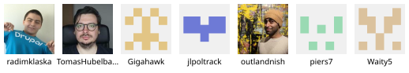

# OneWheel technical info

Visit the site: [https://onewheel.klaska.net](https://onewheel.klaska.net)

# What to expect

I was not able to find much of detailed info about OneWheel internals. My aim is to make this site a "go-to" resource for anyone trying to understand and/or fix their OneWheel by aggregating bits of details I was able to scour the internet for or research myself. (See Credits.)

# Help

* If you have time, please help by extending this page: [https://github.com/radimklaska/onewheel](https://github.com/radimklaska/onewheel)
* If you have money, please motivate me to extend this page: [https://klaska.net/support/](https://klaska.net/support/)

# Disclaimer

This is in no way a tutorial to do anything. I'm not responsible for any damage you cause by using this info. Even though I do my best to verify and double-check I'm not guaranteeing the correctness of the information aggregated in this repo.

OneWheel is a registered trademark of Future Motion, Inc.

I'm not affiliated with Future Motion. I just love the product they make. :)

## Run site locally

Site is based on https://github.com/chrisrhymes/bulma-clean-theme theme.

* See: https://jekyllrb.com/docs/#instructions
* `git clone git@github.com:radimklaska/onewheel.git`
* `cd onewheel`
* `bundle exec jekyll serve`

## Hosting and pull requests

The site is served by a Cloudflare Worker (`wrangler.jsonc`, workflow
`.github/workflows/deploy.yml`): every push to `master` deploys
https://onewheel.klaska.net. Every pull request gets its own preview, linked in a PR
comment with a QR code and Lighthouse scores. When a PR changes the toolchain (Gemfile,
`_config.yml`, `_data/`, `_includes/`, the workflows, ...), every page of the preview is
also compared with production. Same setup as https://cfsite.klaska.net.

# Contributors

